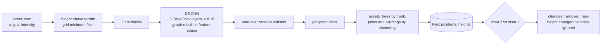

# lidar-gnn-digital-twin

[](https://github.com/darshansatpathy/lidar-gnn-digital-twin/actions/workflows/ci.yml)
[](https://github.com/darshansatpathy/lidar-gnn-digital-twin/actions/workflows/codeql.yml)


A graph neural network that segments mobile-LiDAR street scans into ground, buildings, vegetation, poles and vehicles, and a **digital twin** built from it: an asset registry of poles, trees and buildings with positions and heights, and **change detection** between two scans of the same street.

From [`docs/evaluation-report.md`](docs/evaluation-report.md), on 12 held-out streets (about 104,000 points each) the model never saw:

| Condition | DGCNN mIoU | Gradient boosting on handcrafted features |
|---|---|---|
| Held-out streets | **0.996** | 0.929 |
| Half the point density | **0.994** | 0.856 |
| 5 cm range noise instead of 1.5 cm | **0.994** | 0.684 |
| Buildings taller than any in training | **0.994** | 0.931 |

| Twin | Result |
|---|---|
| Poles, trees, buildings matched to the registry | 74/74, 96/96, 88/89; mean position error 0.09–0.12 m |
| Changes between two scans (pole removed, tree planted, building +3.2 m) | **36 of 36 found, 0 false alarms**, with every parked car moved |

The gap that matters is robustness: handcrafted geometric features break when scans get noisier or sparser; the learned graph features barely move. These are simulator numbers (see Limits).

## Pipeline



- **Data.** Streets are generated and scanned by a simulated mobile scanner that keeps what makes real data hard: density falling with range, surfaces facing away from the scanner missing, ground hidden behind buildings, porous tree crowns, range noise, and intensity that depends on material, incidence and range. Every point has a class and an asset, every street an asset registry, and a second scan with known changes (a pole removed, a tree planted, a building raised by a storey, every parked car moved). Everything regenerates from seeds, so CI needs no download. See [ADR 1](docs/adr/0001-simulated-scans.md) for why, and what that means for the numbers.
- **Model.** A dynamic graph CNN on PyTorch Geometric's `EdgeConv`, with k-nearest-neighbour graphs built in plain PyTorch (no compiled extension needed), 130,181 parameters. Inputs per point: position within its block, height above a terrain model, intensity.
- **Baseline.** Gradient boosting on handcrafted features (height above ground, eigenvalue linearity, planarity, scattering, verticality), so the network has to earn its place. The evaluation fails if it does not beat it.
- **Twin.** Trees are found by their trunks, so touching crowns do not merge; poles and buildings by clustering; assets match the registry within a radius per kind. Vehicles are segmented but kept out of the twin, so they never appear as changes.

## Quick start

```bash
python -m venv .venv && . .venv/bin/activate
pip install torch --index-url https://download.pytorch.org/whl/cpu
pip install -e ".[dev]"

ltw scan --seed 7 --out street.ply             # a simulated scan with true classes (PLY)
ltw twin --seed 2001 --out twin-out            # scan a street twice: twin_before/after.geojson (with changes), classified PLY
ltw evaluate --report docs/evaluation-report.md  # the report below; exit 1 below mIoU 0.85 or at/below the baseline
ltw train                                       # retrain (about an hour on two CPU cores)
```

The committed weights (`models/dgcnn.pt`, 0.5 MB) are a state dict checked against the SHA-256 in `models/dgcnn.json` and loaded with `weights_only=True`, so a weights file cannot run code.

## Limits

- The numbers are for the simulator. What transfers to real scans (Toronto-3D, Paris-Lille-3D, your own mobile mapping) is the pipeline: terrain model, blocks, DGCNN, voting, asset extraction, matching. Expect to retrain.
- Building heights are the highest point the scanner sees on a facade; close to tall buildings that is below the roof line.

## Design decisions

[ADR 1](docs/adr/0001-simulated-scans.md) simulated scans · [ADR 2](docs/adr/0002-dgcnn-with-plain-knn.md) DGCNN with plain k-NN · [ADR 3](docs/adr/0003-twin-from-segmentation.md) the twin from segmentation · [ADR 4](docs/adr/0004-committed-weights-and-gate.md) committed weights and the gate

## License

MIT
